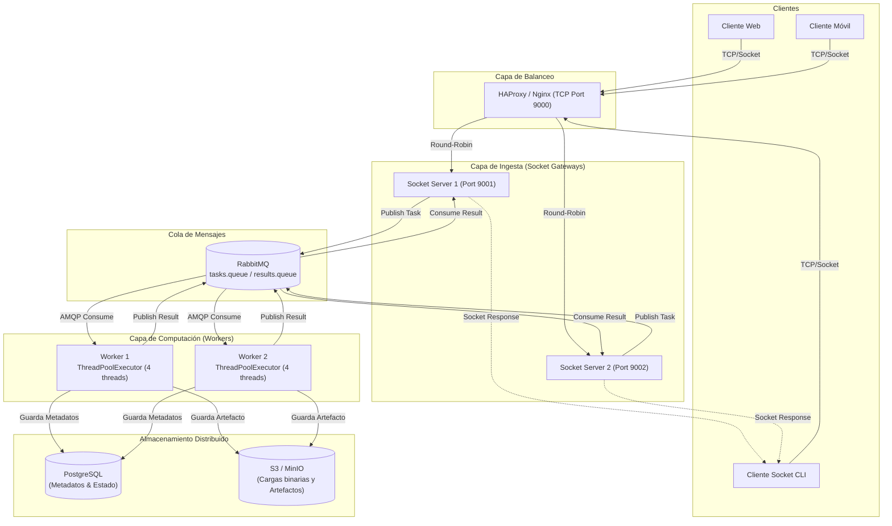

# Sistema Distribuido Basado en Sockets con Workers y Cola de Mensajes

Arquitectura cliente-servidor distribuida de alto rendimiento diseñada para la ingesta masiva de tareas vía TCP Sockets, balanceo de carga L4/L7, desacoplamiento asíncrono con RabbitMQ, procesamiento concurrente en pools de hilos (ThreadPoolExecutor) y almacenamiento persistente distribuido (PostgreSQL y S3/MinIO).

---

## 1. Diagrama de la Arquitectura del Sistema

```
+-----------------------+     +-----------------------+     +-----------------------+
|  Cliente Web / SPA    |     |    Cliente Móvil      |     |  Cliente Socket (CLI) |
|  (HTTP/WebSocket)     |     |   (TCP Socket/REST)   |     |    (TCP Socket puro)  |
+-----------+-----------+     +-----------+-----------+     +-----------+-----------+
            |                             |                             |
            +-----------------------------+-----------------------------+
                                          | [Conexiones TCP / Puerto 9000]
                                          v
                      +---------------------------------------+
                      |      Balanceador de Carga (HAProxy)   |
                      |  - Modo: TCP Stream (L4) / RoundRobin |
                      |  - Health checks activos cada 2000ms  |
                      +-------------------+-------------------+
                                          |
                        +-----------------+-----------------+
                        | [TCP 9001]                        | [TCP 9002]
                        v                                   v
          +---------------------------+       +---------------------------+
          | Servidor Socket Gateway 1 |       | Servidor Socket Gateway 2 |
          | - Ingesta de tramas bin.  |       | - Ingesta de tramas bin.  |
          | - Framing [4B len + JSON] |       | - Framing [4B len + JSON] |
          | - Validación y Handshake  |       | - Validación y Handshake  |
          +-------------+-------------+       +-------------+-------------+
                        |                                   |
                        +-----------------+-----------------+
                                          |
                                          v
                      +---------------------------------------+
                      |       RabbitMQ (Message Broker)       |
                      |  - Exchange: "tasks_exchange" (Direct)|
                      |  - Cola "tasks.queue" (Durable)       |
                      |  - Cola "results.queue" (Durable)     |
                      |  - Dead Letter Exchange (DLX)         |
                      +-------------------+-------------------+
                                          | [AMQP 0-9-1 / Prefetch=4]
                        +-----------------+-----------------+
                        |                                   |
                        v                                   v
          +---------------------------+       +---------------------------+
          |     Worker Server #1      |       |     Worker Server #2      |
          | +-----------------------+ |       | +-----------------------+ |
          | | ThreadPoolExecutor    | |       | | ThreadPoolExecutor    | |
          | | (Pool de 4-8 Hilos)   | |       | | (Pool de 4-8 Hilos)   | |
          | | - CPU Matrix Calc     | |       | | - CPU Matrix Calc     | |
          | | - Image Processing    | |       | | - Image Processing    | |
          | | - Data Aggregation    | |       | | - Data Aggregation    | |
          | +-----------------------+ |       | +-----------------------+ |
          +-------------+-------------+       +-------------+-------------+
                        |                                   |
                        +-----------------+-----------------+
                                          |
                 +------------------------+------------------------+
                 | [SQL Port 5432]                                 | [S3 API Port 9000]
                 v                                                 v
  +-------------------------------+                 +-------------------------------+
  |  PostgreSQL (Metadatos/ACID)  |                 |     S3 / MinIO (Artefactos)   |
  |  - Tabla: tasks (UUID, status)|                 |  - Bucket: "distributed-tasks"|
  |  - Timestamps, métricas, logs |                 |  - Blobs pesados, matrices,   |
  |  - Trazabilidad y auditoría   |                 |    imágenes procesadas        |
  +-------------------------------+                 +-------------------------------+
```

### Diagrama Mermaid



---

## 2. Componentes del Sistema

1. **Clientes (Móviles, Web, CLI)**:
   - Se conectan vía TCP Socket al puerto unificado expuesto por el balanceador.
   - Envían mensajes serializados en formato binario con encabezado de longitud fija.
   - Soportan modos sincrónico (espera bloqueante del resultado) y asincrónico (confirmación de recepción + pooling o streaming).

2. **Balanceador de Carga (HAProxy / Nginx)**:
   - Opera en **Capa 4 (TCP Stream)** para manejar tráfico de sockets puro sin degradación por parseo HTTP.
   - Distribuye conexiones hacia la granja de servidores de socket usando algoritmo **Round-Robin** o **Leastconn**.
   - Ejecuta verificaciones de salud activas (`health checks`) para retirar nodos caídos de manera transparente.

3. **Servidores de Socket (Gateways de Ingesta)**:
   - Escuchan conexiones entrantes mediante sockets TCP multihilo (`ThreadingTCPServer`).
   - Implementan el protocolo de entramado: `[4 bytes Big-Endian: Longitud][Payload JSON en UTF-8]`.
   - Registran el evento inicial en la base de datos (PostgreSQL) con estado `PENDING`.
   - Publican la tarea en la cola de RabbitMQ y esperan el resultado correlacionado para responder al socket del cliente.

4. **Cola de Mensajes (RabbitMQ)**:
   - Desacopla la velocidad de recepción de la velocidad de ejecución de tareas.
   - Utiliza colas durables (`durable=True`) y confirmaciones manuales (`basic_ack`) para garantizar entrega garantizada (*at-least-once*).
   - Maneja Dead Letter Exchanges (DLX) para tareas fallidas repetidamente.

5. **Servidores Workers (con Pool de Hilos)**:
   - Nodos de cómputo distribuidos que consumen tareas de RabbitMQ con `prefetch_count=4`.
   - Cada worker administra un **ThreadPoolExecutor** dedicado con $N$ hilos de trabajo paralelos.
   - Ejecutan tareas intensivas de CPU/IO: cálculo de matrices, procesamiento de imágenes, agregación de datos y hash mining.
   - Suben los artefactos pesados generados al bucket S3/MinIO.
   - Actualizan el estado en PostgreSQL a `COMPLETED` o `FAILED`.

6. **Almacenamiento Distribuido**:
   - **PostgreSQL**: Almacena el registro transaccional estructurado de cada tarea (`task_id`, `status`, `client_id`, `created_at`, `completed_at`, `duration_ms`, `error_message`).
   - **Amazon S3 / MinIO**: Almacena los resultados voluminosos (archivos binarios, matrices serializadas, datasets procesados), evitando sobrecargar la memoria de RabbitMQ y PostgreSQL.

---

## 3. Especificación del Protocolo de Socket

Para evitar el problema común de *TCP Stream Fragmentation* (donde múltiples paquetes pueden unirse o fragmentarse en el buffer de red), se utiliza un **protocolo de longitud prefijada (Length-Prefixed Framing)**:

```
+-----------------------+-----------------------------------------------+
|  Header (4 Bytes)     |  Payload (N Bytes)                            |
|  Entero 32-bit (uint) |  JSON codificado en UTF-8                     |
|  Big-Endian (>I)      |  {"task_type": "...", "params": {...}}        |
+-----------------------+-----------------------------------------------+
```

### Formato de Mensaje de Petición (Request):
```json
{
  "task_id": "9b1deb4d-3b7d-4bad-9bdd-2b0d7b3dcb6d",
  "client_id": "cli_client_01",
  "task_type": "matrix_mult",
  "priority": "high",
  "payload": {
    "size": 128,
    "seed": 42
  },
  "timestamp": 1729000000.123
}
```

### Formato de Mensaje de Respuesta (Response):
```json
{
  "task_id": "9b1deb4d-3b7d-4bad-9bdd-2b0d7b3dcb6d",
  "status": "COMPLETED",
  "worker_id": "worker-1",
  "thread_id": 3,
  "execution_time_ms": 142.5,
  "s3_artifact_url": "s3://distributed-tasks/artifacts/9b1deb4d-matrix.json",
  "result_summary": {
    "matrix_trace": 16384.0,
    "dimensions": [128, 128]
  },
  "error": null
}
```

---

## 4. Requisitos y Dependencias

- Python 3.10 o superior
- Docker y Docker Compose (opcional para el despliegue completo)
- Dependencias de Python (`requirements.txt`):
  - `pika>=1.3.2` (Driver oficial de RabbitMQ)
  - `psycopg2-binary>=2.9.9` (Driver de PostgreSQL)
  - `boto3>=1.34.0` (SDK de S3 / MinIO)
  - `pytest>=8.0.0` (Para ejecutar las pruebas)

---

## 5. Instrucciones de Configuración y Ejecución

### Opción A: Despliegue Rápido con Docker Compose (Recomendado)

Inicia todos los servicios del sistema distribuido con un único comando:

```bash
# 1. Clonar el repositorio
git clone https://github.com/tu-usuario/sistema-distribuido-sockets.git
cd sistema-distribuido-sockets

# 2. Levantar la infraestructura completa (HAProxy, RabbitMQ, Postgres, MinIO, Servers, Workers)
docker-compose up --build -d

# 3. Verificar estado de los contenedores
docker-compose ps
```

Puertos expuestos:
- **HAProxy (Load Balancer Socket)**: `localhost:9000`
- **RabbitMQ Management Dashboard**: `http://localhost:15672` (usuario: `guest`, clave: `guest`)
- **MinIO S3 Console**: `http://localhost:9001` (usuario: `minioadmin`, clave: `minioadmin`)
- **PostgreSQL**: `localhost:5432` (bd: `tasks_db`, usuario: `postgres`, clave: `postgres`)

---

### Opción B: Ejecución Local en Python (Modo Standalone / Desarrollo)

El código incluye adaptadores con fallback automático a colas en memoria y almacenamiento local SQLite si RabbitMQ o PostgreSQL no están corriendo localmente.

```bash
# 1. Crear entorno virtual e instalar dependencias
python3 -m venv venv
source venv/bin/activate  # En Windows: venv\Scripts\activate
pip install -r requirements.txt

# 2. Terminal 1: Iniciar el Servidor de Sockets
python server.py --port 9001 --server-id srv-1

# 3. Terminal 2: Iniciar el Worker con pool de hilos
python worker.py --worker-id wrk-1 --threads 4

# 4. Terminal 3: Enviar tareas usando el Cliente
python client.py submit --task-type matrix_mult --size 64
```

---

## 6. Uso del Cliente de Sockets (`client.py`)

El cliente incluye múltiples modos de interacción por línea de comando:

### 1. Envío Sincrónico de Tareas
```bash
# Multiplicación matricial intensiva
python client.py submit --task-type matrix_mult --size 128

# Filtro de procesamiento de imagen
python client.py submit --task-type image_filter --filter-name gaussian_blur

# Agregación y estadística de datos
python client.py submit --task-type data_aggregate --sample-count 50000

# Hash mining (prueba de trabajo)
python client.py submit --task-type hash_mining --difficulty 4
```

### 2. Envío Asincrónico y Consulta de Estado
```bash
# Enviar tarea y recibir ID de seguimiento
python client.py async-submit --task-type matrix_mult --size 256
# Output: Tarea registrada con ID: d4f9c5a1-77d2-4e08-9584-3f2d87e1a39b

# Consultar el estado y resultado de una tarea previa
python client.py poll --task-id d4f9c5a1-77d2-4e08-9584-3f2d87e1a39b
```

### 3. Prueba de Carga y Benchmark Concurrente
Simula múltiples clientes concurrentes enviando tareas al balanceador de carga:

```bash
# Enviar 50 tareas utilizando 10 clientes concurrentes
python client.py benchmark --tasks 50 --concurrency 10 --task-type matrix_mult
```

Salida del Benchmark:
```text
==================================================
           REPORTE DE BENCHMARK DISTRIBUIDO
==================================================
Total de tareas solicitadas:   50
Conexiones simultáneas:        10
Tareas completadas con éxito:  50 (100.0%)
Tiempo total transcurrido:     2.84 s
Throughput del sistema:        17.60 tareas/segundo
Latencia Mínima:               45.2 ms
Latencia Media (p50):          128.4 ms
Latencia Percentil 95 (p95):   210.1 ms
Latencia Máxima (p99):         245.8 ms
==================================================
```

---

## 7. Ejecución de Pruebas Unitarias y de Integración

```bash
# Ejecutar la suite completa de pruebas
pytest -v test_suite.py
```

Las pruebas cubren:
- Empaquetado y desempaquetado de tramas binarias (Endianness y bytes framing).
- Conexión y reconexión TCP ante cortes temporales de red.
- Concurrencia de múltiples hilos en el pool de workers sin race conditions.
- Manejo de tareas inválidas y timeouts.

---

## 8. Estrategias de Tolerancia a Fallos y Escalabilidad

1. **Caída de un Servidor Gateway**: HAProxy detecta el fallo del socket en 2000 ms y redirige el tráfico al nodo remanente sin pérdida de estado, ya que el estado reside en RabbitMQ y PostgreSQL.
2. **Caída de un Worker**: RabbitMQ no recibe el `basic_ack` de la tarea en curso. Al desconectarse el canal AMQP, la tarea es devuelta automáticamente a la cola (`requeue=True`) y tomada por otro worker saludable.
3. **Picos de Demanda (Backpressure)**: La cola RabbitMQ amortigua el tráfico absorbiendo miles de tareas en cola mientras los workers procesan a capacidad nominal constante sin agotar los recursos del servidor socket.
4. **Almacenamiento Separado**: PostgreSQL maneja consultas ACID ultrarrápidas de índices y estado, mientras que S3 absorbe los GBs de datos binarios resultantes.
